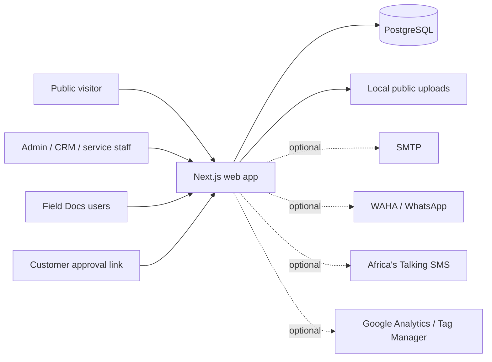

# Architecture

**Status:** Describes the repository implementation inspected on 2026-11-03.\
**System boundary:** Root Next.js application and its PostgreSQL dependencies.

## Context

The web app is server-rendered and requires a persistent Node.js process. It is not a static export. It serves public pages, admin pages and APIs, and Field Docs from one Next.js application.

## Technology and Ownership Boundaries

| Area | Implementation | Data boundary |
| --- | --- | --- |
| Web application | Next.js 16 App Router, React 19, TypeScript, JavaScript route modules | Root `app/` and `components/` |
| Public website | Server-rendered pages, metadata, contact and inquiry handlers | CMS/catalog models in default PostgreSQL schema |
| Admin workspace | Next.js layouts, React panels and API route handlers | Sequelize models in `server/models/` |
| CMS/catalog/CRM/service | Sequelize models for CMS, catalog, CRM, fulfillment and platform entities | PostgreSQL default schema; SQL migrations under `server/migrations/` |
| Field Docs | Next.js pages/API routes; PostgreSQL `pg` pool | Separate `field_docs` schema; tables initialized on first request by `lib/fieldDocs/db.js` |
| Uploads | Local filesystem paths under `public/uploads/` | Must be persisted and backed up with the deployment; verify production storage policy |
| Production server | Next standalone output | `.next/standalone`, with static assets and `public/` copied by build preparation |
| Tests | Playwright, one Chromium worker | Tests share a database and start or reuse the dev server |

`server/` is a shared data layer, not a separate Express server. The retired `legacy-express/` bundle is not part of this system.

## Request and Authentication Flows

### Public site and admin

- Browser requests are routed to Next.js pages or `app/api/**/route.*` handlers.
- Admin pages are matched by `proxy.ts`, which checks the `admin_session` JWT cookie and redirects unauthenticated users to `/admin/login`.
- Admin layout calls `getAdminSession()` again. API mutations use `requireSession()`/route-level checks; keep authorization close to data operations rather than relying only on the proxy.
- Admin password hashes are managed by the `Admin` Sequelize model using bcrypt. Admin cookie is HTTP-only, SameSite Lax, seven days, and Secure in production.
- Set a high-entropy `JWT_SECRET`. `JWT_EXPIRES_IN` defaults to seven days.

### Field Docs

- Field Docs login uses email/password and a separate `fd_sid` cookie; it does not share Nanosoft Admin identity.
- `lib/fieldDocs/auth.js` signs the session with `FIELD_DOCS_SESSION_SECRET`, but currently falls back to `dev-secret`. That fallback is development-only and must never be accepted for production.
- Field Docs roles include `admin`, `supervisor` and `tech`. UI and data access are role-scoped in multiple workflows; verify API authorization for every privileged action before expanding roles.
- Client approvals use tokenized links. Treat those links as bearer credentials and define expiry/retention with the product owner.

## Data Model

### Main schema

- **CMS:** singleton site content, pages, posts, tags, comments, reactions, events, team members, testimonials, menu items, subscribers and page views.
- **Catalog:** products and product categories.
- **CRM:** companies, contacts, deals, messages, activities and WhatsApp messages.
- **Fulfillment/service management:** suppliers, technicians, service requests, incidents, client devices, maintenance logs and assignments.
- **Platform:** admin accounts, audit logs, integrations, tasks, notes, object/field metadata and generic records.

SQL migrations are applied in sorted filename order and recorded in `schema_migrations`. The bootstrap seed then runs Sequelize `sync()` and inserts initial admin/content/catalog rows only when absent. Existing records are not a replacement for backup or migration review.

### Field Docs schema

Field Docs initializes `field_docs` tables at first data access. Its domain includes users, clients, products/templates, work orders, tasks/subtasks, task events/spans, documents, approvals, schedules, assets, attachments, notification settings and audit/events. This initializer uses PostgreSQL-specific DDL.

### Custom objects and fields status

A migration, Sequelize models, `lib/crudOperations.ts` and `components/admin/DynamicForm.tsx` provide a partial foundation for metadata-driven records. A route/UI integration for managing object metadata, fields and generic records was not found. Document this as partial infrastructure, not as a user-available custom-object feature.

## Runtime Configuration and External Services

See [Developer and Operations Handover](DEVELOPER_OPERATIONS_HANDOVER.md) for variable names and procedures. High-level configuration:

- `DATABASE_URL`, `DB_DIALECT=postgres`, optional `DB_SSL=true`.
- Admin JWT and initial-admin credentials.
- Separate Field Docs initial-admin credentials, session secret and HTTPS cookie setting.
- SMTP settings for form notifications, reminders and Field Docs emails. Some modules use `SMTP_PASS`; others use `SMTP_PASSWORD`; configure both if both paths are enabled.
- WAHA configuration for WhatsApp, Africa's Talking credentials for SMS, and optional analytics identifiers.

Integration credentials may also be stored in the admin integration records. Use the actual integration settings screen and server configuration as the source of truth; never put secrets in documentation or browser-visible variables.

## Deployment Shape

1. Install with `npm ci` on a Node.js version supported by the installed Next.js.
2. Configure PostgreSQL and application environment variables.
3. Run `npm run build`. It runs migrations, seeds bootstrap data, builds Next.js and copies static/public files into standalone output.
4. Run `npm start` under a persistent process manager. It again runs migrations and seed before starting the standalone server.
5. Provide persistent storage for uploads and an independent database backup/restore process.

The scripts print detected LAN URLs for local access. On port conflict, use the actual port in the Next.js startup banner. Development mode is for trusted private networks only.

## Architecture Constraints and Follow-up

- MySQL is not end-to-end supported even though `mysql2` and a Sequelize dialect option exist.
- Field Docs schema creation occurs at runtime on first use; review whether production schema changes should move to a controlled migration process.
- Verify upload persistence across redeploys and define backup/retention for `public/uploads/`.
- Audit authorization at every API route, particularly admin role distinctions, Field Docs privilege checks and customer-token routes.
- Document data ownership, tenancy boundaries and retention before adding customers or teams with different access boundaries.
- The current Git history is insufficient to provide a complete decision trail. Add ADRs and reviewable commits going forward.
